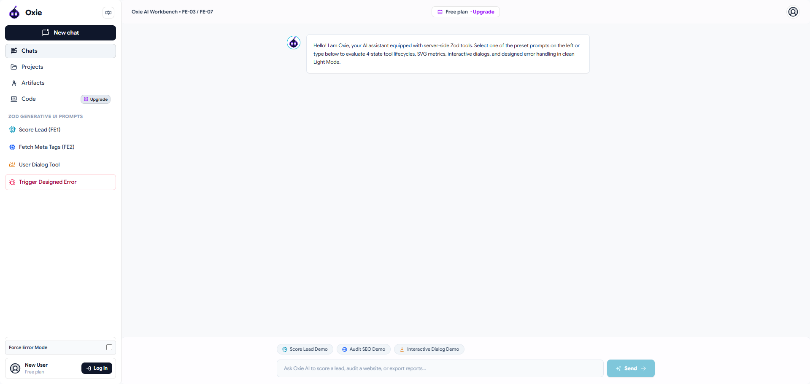

# FE-03 / FE-07: Tool Results & Structured Output in the UI

[](https://nextjs.org/)
[](https://react.dev/)
[](https://www.typescriptlang.org/)
[](https://tailwindcss.com/)
[](https://sdk.vercel.ai/)
[](https://zod.dev/)

> **Generative UI Application** demonstrating server-side AI tools defined with Zod schemas, 4-state lifecycle visualization (`input-streaming`, `input-available`, `output-available`, `output-error`), Framer Motion 200ms morphing transitions, SVG metric gauge charts, interactive user confirmation tools, and designed error handling.

---

## 📸 Application UI Preview



---

> [!NOTE]
> **Why It Matters**: Real AI products call tools and return structured data your UI must render as interactive components. This generative UI skill separates a basic chat wrapper from a modern AI application.

---

## 📐 Tool Contracts

### 1. `scoreLead` (FE1 Lead Scoring Tool)

- **Description**: Calculates lead qualification score (0–100), lead tier (`HOT`, `WARM`, `COLD`), breakdown metrics, estimated revenue, and action recommendations.
- **Zod Schema**:
  ```ts
  z.object({
    companyName: z.string().describe('The official name of the company or prospect organization'),
    companySize: z.enum(['1-10', '11-50', '51-200', '201-1000', '1000+']).describe('Number of employees'),
    budget: z.number().min(0).describe('Annual allocated software budget in USD'),
    useCase: z.string().describe('Primary business objective or project requirements'),
    contactEmail: z.string().email().describe('Primary contact email address for validation'),
  })
  ```
- **Return Data Shape**:
  ```ts
  interface LeadScorerResult {
    leadId: string;
    companyName: string;
    overallScore: number; // 0 - 100
    tier: 'HOT' | 'WARM' | 'COLD';
    metrics: {
      budgetFit: number;
      teamFit: number;
      intentScore: number;
      urgencyRating: 'High' | 'Medium' | 'Low';
    };
    estimatedRevenue: string;
    keyRecommendations: string[];
    scoredAt: string;
  }
  ```
- **UI Component**: `LeadScoreResult.tsx` featuring an animated radial SVG gauge chart, tier badge, progress bars, and recommendation checklist.

---

### 2. `fetchMetaTags` (FE2 Website SEO Audit Tool)

- **Description**: Fetches website meta tags, title, description, OpenGraph properties, mobile readiness, and SEO performance grade.
- **Zod Schema**:
  ```ts
  z.object({
    url: z.string().describe('Target web address URL to inspect'),
    checkOgTags: z.boolean().describe('Include social media Open Graph preview inspection'),
  })
  ```
- **Return Data Shape**:
  ```ts
  interface MetaInspectorResult {
    url: string;
    domain: string;
    title: string;
    description: string;
    ogImage: string;
    seoScore: number;
    mobileReady: boolean;
    performanceGrade: 'A+' | 'A' | 'B' | 'C' | 'F';
    tagsFound: { name: string; content: string; status: 'ok' | 'warning' | 'missing' }[];
    issues: string[];
    inspectedAt: string;
  }
  ```
- **UI Component**: `MetaInspectorResult.tsx` rendering detected tags table, OpenGraph social card preview mockup, and SEO health badges.

---

### 3. `confirmLeadExport` (User Interaction Tool)

- **Description**: Exports lead report data to external CRM/files. Requires explicit client-side user confirmation before execution.
- **Zod Schema**:
  ```ts
  z.object({
    leadId: z.string().describe('Unique Lead ID to be exported'),
    exportFormat: z.enum(['CSV', 'JSON', 'Salesforce', 'HubSpot']).describe('Target platform format'),
    recipientEmail: z.string().email().describe('Email to receive export notification'),
  })
  ```
- **Return Data Shape**:
  ```ts
  interface LeadExporterResult {
    exportId: string;
    leadId: string;
    status: 'COMPLETED' | 'CANCELLED';
    format: string;
    recipientEmail: string;
    timestamp: string;
  }
  ```
- **UI Component**: `UserConfirmationDialog.tsx` rendering authorization prompt card with interactive "Approve & Execute Export" and "Cancel" buttons.

---

## 🔄 4-State Tool Lifecycle Matrix

```
┌───────────────────┐    200ms Morph    ┌───────────────────┐
│ 1. input-streaming│ ────────────────> │ 2. input-available│
│ (Shimmer Skeleton)│                   │ (Parameters Ready)│
└───────────────────┘                   └───────────────────┘
                                                  │
                                       ┌──────────┴──────────┐
                                       │ Execute Server Tool │
                                       └──────────┬──────────┘
                                                  │
                        ┌─────────────────────────┴─────────────────────────┐
                        ▼                                                   ▼
              ┌───────────────────┐                               ┌───────────────────┐
              │ 3. output-available│                              │  4. output-error  │
              │ (Generative UI Card)│                             │ (Designed Error)  │
              └───────────────────┘                               └───────────────────┘
```

| Lifecycle State | State Machine Question | Visual UI Treatment |
| :--- | :--- | :--- |
| **`input-streaming`** | *What is the model doing?* | Animated shimmering skeleton with live streaming parameter badges (`Generating parameters...`) |
| **`input-available`** | *With what input is it running?* | Validated Zod schema parameter chip panel with active execution spinner |
| **`output-available`** | *What came back?* | Rich Generative UI Component (`LeadScoreResult` with radial SVG gauge meter or `MetaInspectorResult`) |
| **`output-error`** | *What went wrong?* | Designed error card with error code badge (`SERVICE_UNAVAILABLE`), technical stack trace toggle, user explanation & retry action button |

---

> [!TIP]
> **State Machine Motion**: Transitions between tool states use Framer Motion 200ms morphing crossfades (`mode="wait"`), ensuring smooth visual feedback without layout jumps.

---

## 🚀 Running Locally

1. **Install Dependencies**:
   ```bash
   npm install
   ```

2. **Start Dev Server**:
   ```bash
   npm run dev
   ```

3. **Open Browser**:
   Navigate to [http://localhost:3000](http://localhost:3000)

---

> [!IMPORTANT]
> **Repository Link**: [GitHub Repository](https://github.com/CoderGUY47/FE-07-Tool-results-and-structured-output-in-the-UI)
